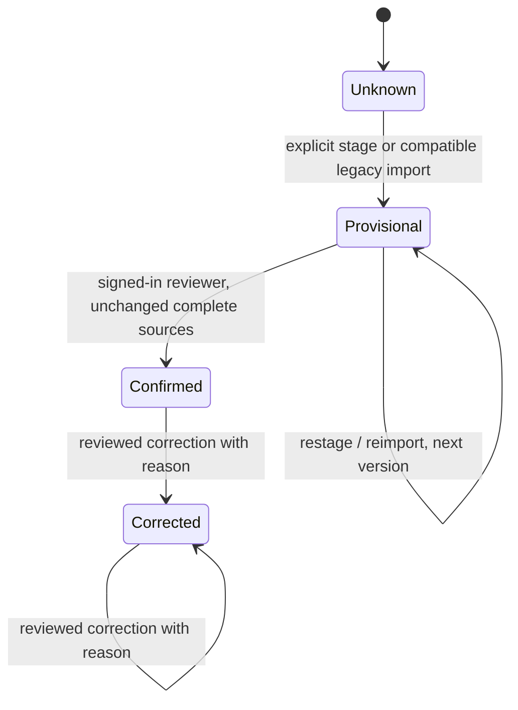

# Reviewed results

Logi owns collection and immutable result review records. Websites read explicit review state through `result-summaries` and retain their own publishing policy and consent. Review does not automatically establish a player's Logi identity.

## Lifecycle and persistence



Every saved revision is a new `eventResultRevisions` row containing the event,
guild, game, version, participant scores, provenance and private player attribution.
`expectedRevision` is a compare-and-set precondition (0 when absent). Appending
the revision and updating the event's minimized head happen in one Convex
transaction; concurrent or stale commands conflict rather than overwrite.

Confirmation records the authenticated reviewer and timestamp. Correction records
its reason and superseded version; earlier rows remain intact. The management UI
shows the latest 20 revisions; this is a read bound, not deletion of old revisions.
No automatic promotion, bulk identity verification, nickname match, destructive
history edit or result-retraction command is included.

An HLL source link is explicit and binds a stored session ID, provider, external
ID, digest, map, time range and completeness to the event's guild/game. Confirmation
re-reads those sources: changed digest or incomplete session requires restaging.
A later provider update cannot change an already confirmed snapshot. Up to four
sessions may be combined with explicit manual scores; Logi does not guess series
aggregation. The current picker selects one source or keeps existing links and
offers the 50 most recently fetched HLL sessions. The API accepts older known IDs.

Participants are 2–16 distinct IDs with display labels and finite numeric or null
scores. `0` is a known score; `null` is unknown. A reviewer may explicitly confirm
an unknown score; confirmation means reviewed, not complete knowledge or game
ownership. Wardogs supports manual N-faction results. Its current adapter has no
verified historical-session capability; this delivery does not invent one.

## Verified player attribution

The private revision deduplicates at most 300 source players. Only an active I5
Steam proof whose stored user record still has the same explicit Discord identity
can supply a Logi user ID. Claimed profile IDs, numeric import IDs, names, revoked
or ambiguous links remain unresolved. Attribution is refreshed at confirmation
and correction; unlinking between stage and confirm therefore removes attribution.

Existing reviewed snapshots describe the evidence at review time and are not
rewritten on later unlink. New reviews use current proof. Public results expose
only verified/unresolved counts, never a Steam ID, Logi player ID or Discord ID.
This is identity evidence, not proof of a game license, team membership or attendance.

## Session-only management

`GET|POST /api/servers/{serverId}/events/{eventId}/results?game={gameId}`

Requires the signed-in Logi account, an explicit single game, a match in the same
workspace and the existing dashboard data-administrator policy. The route derives
guild, event, game and actor from its trusted context and rechecks access; the
Convex handler checks them again. POST also requires the canonical same-origin
`Origin` (`SITE_URL`). Every response is `Cache-Control: no-store`.
GET source candidates include nullable provider `startedAt` and `endedAt`
timestamps. The dashboard labels both candidates and saved session links by
`endedAt` in the workspace timezone, showing unknown when no end is recorded.

This uses Logi's existing data-management administrator policy, including its
stored administrator IDs and access overrides. Reviewed data management does not grant Discord role authority. Review requires an authorized dashboard session. Body-supplied actor IDs,
admin booleans and unknown fields are rejected. Clan bearer keys cannot perform
this lifecycle, including legacy full-access keys. This is the deliberate API
parity exclusion: a consumer key cannot impersonate a human reviewer.

Examples (synthetic IDs; send with the account session):

```json
{
    "action": "stage",
    "expectedRevision": 0,
    "sessionLinks": ["stored-session-id"]
}
```

```json
{ "action": "confirm", "expectedRevision": 1 }
```

```json
{
    "action": "correct",
    "expectedRevision": 2,
    "sessionLinks": [],
    "participants": [
        { "id": "a", "label": "Faction A", "score": 0 },
        { "id": "b", "label": "Faction B", "score": null },
        { "id": "c", "label": "Faction C", "score": 7 }
    ],
    "reason": "Reviewed score correction"
}
```

Confirmation cannot also edit participants, source links or reason. Review the
displayed saved version first. GET returns `current`, `history`, source candidates
and `hasLegacyImport`. A successful POST returns the revision. Invalid game/body
is 400, failed session/scope/origin is 403, revision conflict is 409. Other source,
validation or backend failures return a generic 503 with no internal detail;
refresh and check access/source changes before retrying. Failed requests do not
represent saved approval. The UI disables confirmation while edits are unsaved.

## Website read contract — OpenAPI 1.6.0

| Route                                                                               | Meaning                                                                     |
| ----------------------------------------------------------------------------------- | --------------------------------------------------------------------------- |
| `GET /api/v1/clan/result-summaries?game=hell_let_loose`                             | Paginated match-event summaries; standard limit/cursor/updatedSince filters |
| `GET /api/v1/clan/result-summaries/{eventId}`                                       | Event identity, not imported match identity                                 |
| `GET /api/v1/clan/sync-records/result-summaries/{eventId}?game=hell_let_loose`      | Atomic projection and decimal synchronization revision                      |
| `GET /api/v1/clan/changes?game=hell_let_loose&resources=result-summaries&start=now` | Existing signed-cursor change contract; see 0.6 for exact paging            |

Restricted keys need their own `result-summaries` grant plus allowed games;
`match-summaries` does not imply it. The key form keeps its earlier two default
summary grants; an administrator selects reviewed results explicitly. Existing
unrestricted keys retain legacy read behavior, but still gain no review command.
Collection requests require explicit game selection for restricted keys; detail
reads enforce the stored record's tenant/game. Responses are non-cacheable.

The closed DTO has `id`, `eventId`, `guildId`, `gameId`, `title`, `updatedAt`,
`resultState` and nullable `result`. A result contains version/status, participants,
minimal source provenance, review timestamp, superseded version and attribution
counts. It excludes source addresses, credentials, hashes, raw telemetry, player
identities, reviewer identities and free-text correction reasons. Private history
is available only through the management route.
Generic `events` responses and their mutation/webhook payloads omit the stored
review head entirely, so an event grant cannot bypass the independent result
grant or expose a previous game's frozen head. The OpenAPI event schema makes
the same exclusion.

Result revisions and integration resource revisions are separate counters. A source refresh does not alter frozen reviewed scores. `/clan/changes` cursor replay returns `410 reset_required`; consumers rebuild result projections through the scoped collections. See [synchronization](../v0.6/README.md).

## Consumer fixtures and mapping

All fixtures are synthetic `{ "data": ... }` detail responses, checked against
the closed production schema by `result-summaries.test.ts`.

| Fixture                                            | Required consumer behavior                                             |
| -------------------------------------------------- | ---------------------------------------------------------------------- |
| [Unknown](fixtures/unknown.json)                   | Show no reviewed result, never `0:0`                                   |
| [Provisional](fixtures/provisional.json)           | Clearly label unconfirmed; preserve 0 versus null                      |
| [Confirmed](fixtures/confirmed.json)               | Display reviewed version without inferring publication permission      |
| [Corrected](fixtures/corrected.json)               | Replace the current projection and retain superseded-version reference |
| [Wardogs factions](fixtures/wardogs-factions.json) | Render three participants, not a forced two-team score                 |

Do not derive a winner from incomplete scores or coerce absent scores to zero.
Treat participant IDs as opaque per-result identities, not user IDs. Publication,
CMS approval, website access and consent remain consumer decisions.
